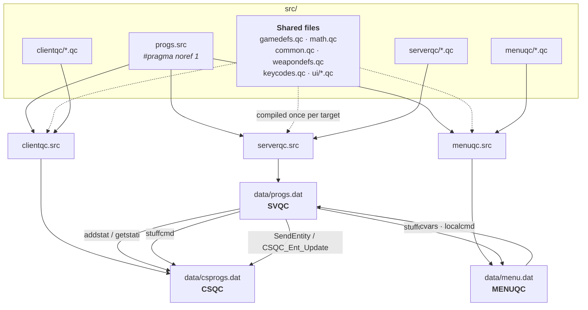

# 01 — Architecture

## Three programs, one source tree

FTEQCC compiles `src/` into **three separate QuakeC programs**. Each runs in its
own virtual machine against a different engine ABI, and they cannot call each
other — everything crossing a VM boundary goes through an explicit channel.

Running the compiler with no arguments reads `src/progs.src`, which fans out to
three sub-manifests:

```bash
cd src && ./fteqcc64.exe
```

| Manifest | Output | `#define` | Runs on | Owns |
| --- | --- | --- | --- | --- |
| `src/serverqc/serverqc.src` | `data/progs.dat` | `SVQC` | server | gameplay, entities, AI, physics authority |
| `src/clientqc/clientqc.src` | `data/csprogs.dat` | `CSQC` | each client | HUD, view, prediction, camera interpolation |
| `src/menuqc/menuqc.src` | `data/menu.dat` | `MENUQC` | client, always | main menu, server browser, save/load UI |

`MENUQC` is the odd one: it is loaded before any server exists and stays loaded
for the whole session, which is why it owns "Create Server" and the load-game
flow.



## Shared files are compiled more than once

Files at `src/` root — `gamedefs.qc`, `math.qc`, `common.qc`, `weapondefs.qc`,
`keycodes.qc`, and everything in `src/ui/` — appear in several manifests. They
are compiled **once per target**, against different engine ABIs, producing a
separate copy of every symbol in each `.dat`.

Two consequences that bite:

1. **Code that must differ per side is guarded** with `#ifdef SVQC` / `#ifdef
   CSQC` / `#ifdef MENUQC`. Those defines come from the `.src` manifest, not the
   compiler command line.
2. **A prototype in a shared file whose definition lives only under `serverqc/`
   is an orphan** in the client and menu builds — even though a whole-tree scan
   sees it resolved. Six such prototypes exist today and are harmless only
   because nothing on the client side calls them — but one that *is* referenced
   ships with no body, which builds clean and crashes at runtime.

The `.src` files are flat include lists with no automatic fan-out. **Adding a new
shared file means adding it to every manifest that needs it.**

## `#pragma noref` and the silent null-function bug

`src/progs.src` sets `#pragma noref 1`. This applies the `noref` type modifier to
every following definition, which does two things: it suppresses "unused"
warnings, and it lets the compiler strip a definition that is **neither
referenced nor initialised**. Its practical purpose here is silencing the warning
noise from the vendored `*extensions.qc` and defs files, which declare far more
than this project uses.

Note the "nor initialised" half. A spawn function has a body, so it is
initialised and is never a candidate for stripping — the engine calling it by
name from the map's `classname` key is safe regardless of this pragma.

What *is* uninitialised is a **forward declaration with no matching definition**,
and that is this project's nastiest failure mode. Unreferenced, it is silently
stripped (which is what `--check-orphans` reports as benign). Referenced from a
call site, the symbol can ship with no body: clean build, null-function call at
runtime.

Three prototype forms exist and it is easy to see only the first:

```c
void Foo(entity e);              // modern
void(entity e) Foo;              // old-style  <- easy to miss
void(entity e) Foo               // old-style definition, body brace next line
{
```

## Two engines, one codebase

Zircon (DarkPlaces-derived) is the primary target; FTEQW is the compatibility
target. They differ in ways that produce no warning, so `common.qc` exposes a
runtime `IsFTE()` check for the handful of places that must branch.

| Feature | FTE | DarkPlaces / Zircon |
| --- | --- | --- |
| `frameforname` / `frameduration` | yes | **no** — per-monster `.frameByName` resolver |
| Use button | `self.button5` | `self.buttonuse` |
| Brush contents override (`skin` key) | native | needs baked water content |
| `tcGen environment` on skeletal models | **broken** — needs a GLSL `program` | works |
| `$lightmap` on models | resolves to white (no-op) | genuinely shades the model |
| Player model split | `basebone` dual skeleton | two entities (torso + legs) |

FTE-only language features used throughout: `addstat`/`getstati`,
`tokenizebyseparator`, `sprintf`, `localcmd`, `drawpic`/`drawfill`/`drawstring`,
the ternary `?:`, compound assignment, for-loops, and integer-ish array indices.

## Where things live

```
src/
  progs.src              root manifest, fans out to three
  gamedefs.qc            shared constants, fields, WEAPON_* bits, FCAP_*, USE_*
  weapondefs.qc          the weapon registry (single source of truth)
  math.qc common.qc      shared helpers
  progsdefs.qc           stock Quake ABI -- ORDER-locked, never edit casually
  dpextensions.qc dp.qc  DarkPlaces/FTE builtin prototypes
  ui/                    shared between clientqc and menuqc
  serverqc/
    main.qc client.qc    worldspawn, StartFrame, ClientConnect, PutClientInServer
    subs.qc combat.qc    target chains, damage pipeline
    ai/                  shared monster AI + the info_node graph
    func/                brush entities, triggers, env_*, scripted sequences
    monster/  monster/q1 Half-Life monsters, and the Quake 1 bestiary
    weapons/  items/     per-weapon implementations, pickups
    player/              spawn, movement, stance, use, transfer
  clientqc/              HUD, view, prediction
  menuqc/                main menu
```

---

Next: [02 — Lifecycle](02-lifecycle.md)
