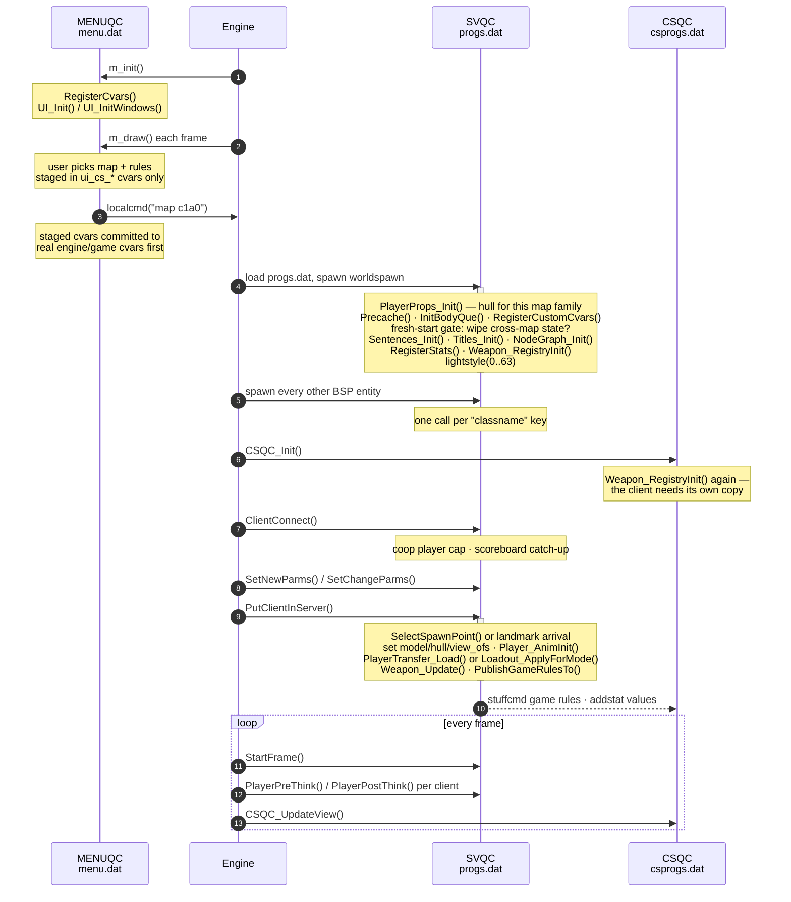
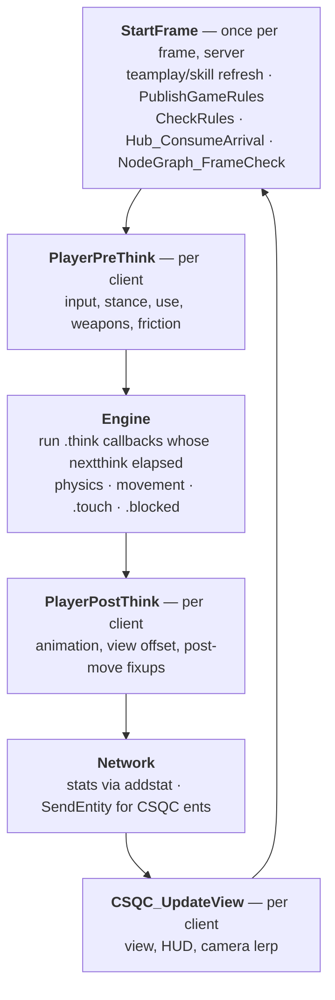

# 02 — Lifecycle: launch to first frame

This is the spine of the whole system. Everything else in the guide hangs off a
step in this sequence.

## Boot → player standing in the world



### `worldspawn` — once per map load

`serverqc/main.qc`. Order matters here more than anywhere else in the codebase.

1. `PlayerProps_Init()` — picks the player hull and eye height for this map
   family. Half-Life maps use a 68-unit player; id1 maps use Quake's 56. Getting
   this wrong makes the player stick in doorways.
2. `Precache()` — register everything the map can reference. Precaching later
   than the spawn phase produces a warning (suppressible) rather than an error,
   but keeping it here is what guarantees the asset is registered before anything
   asks for it.
3. **The fresh-start gate.** Cross-map state is wiped *unless* this load is a
   transfer, a pending save load, a hub restore, or a death restart:

   ```c
   if (cvar("xfer_valid") != 1
       && cvar_string("g_pendingLoad") == ""
       && cvar_string("hub_restore_pending") == ""
       && cvar("g_deathRestart") != 1)
   {
       GlobalState_ClearAll();
       PlayerTransfer_Clear();
       ...
   }
   ```

   Without it, starting a new game hands the player whatever the previous
   session left staged. See [09 — Persistence](09-persistence.md).
4. `Sentences_Init()`, `Titles_Init()`, `Sprite_FrameManifestInit()` — parse the
   text data files.
5. `NodeGraph_Init()` — prepares the AI graph; the actual build is deferred to
   the first frame because `info_node` entities have not spawned yet.
6. `RegisterStats()` — binds server fields to numbered stats the client reads
   with `getstati`. This is the main SVQC→CSQC channel.
7. `Weapon_RegistryInit()` + `Weapon_RegisterSelectFuncs()`.

### Entity spawn

After `worldspawn` returns, the engine walks the rest of the BSP entity lump.
For each entity it assigns the keyvalues to matching fields **by exact name**,
then calls the global QC function named by the `classname` key. Covered in
[03 — Entities](03-entities.md).

### `PutClientInServer` — once per life

Called on connect, on respawn, and on every level change. It is the only place
the player entity is fully rebuilt, and it must reset anything that would
otherwise survive from the previous life — the client edict is reused, so
armour, flashlight, and stance all carry over if not explicitly cleared.

The branch that matters is the arrival path:

- **Landmark arrival** — single-player only, when a `trigger_changelevel`
  staged a landmark. Position is the player's old position plus the landmark
  offset, so they walk out of the corresponding door in the new map.
- **Hub restore** — a revisit; the engine snapshot has already restored the
  world, so inventory is left alone.
- **Everything else** — a normal spawn point via `SelectSpawnPoint()`.

Coop deliberately does *not* use landmark arrival: it carries inventory across
the transition but regroups everyone at the map's coop spawn points rather than
scattering them wherever they each happened to be standing.

## The frame loop



Two things about `StartFrame` are worth knowing:

- `NodeGraph_FrameCheck()` builds the AI node graph on the **first frame only**.
  It cannot run in `worldspawn` because the `info_node` entities have not spawned
  yet — each one increments `placed_count` from its own spawn function, and the
  build needs the final total. (The builder hull it validates links with is
  spawned and removed inside `NodeGraph_Build` itself, so that is not a
  constraint on when it runs.)
- `PublishGameRules()` runs every frame but only sends when a value actually
  moved. A remote client's `gamemode`/`coop`/`deathmatch` cvars are leftovers
  from whatever it last hosted, so the server overwrites the client's own copies
  with `stuffcmd` — otherwise the scoreboard, kill feed, and team dialog all read
  the wrong mode.

## Entity thinking

QuakeC has no scheduler. An entity runs again when the engine notices
`self.nextthink` has elapsed and calls `self.think`. A think that forgets to set
the next `nextthink` simply stops forever.

```c
self.think     = MyThink;
self.nextthink = time + 0.1;
```

---

Previous: [01 — Architecture](01-architecture.md) · Next: [03 — Entities](03-entities.md)
