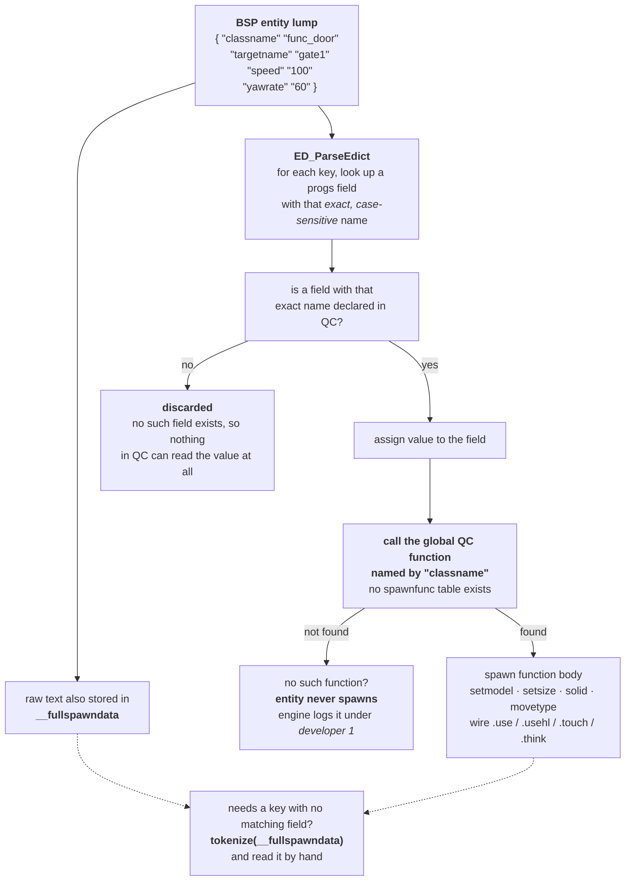

# 03 — Entities and the spawn contract

Everything in a level except the player arrives from the BSP entity lump: a text
blob of `"key" "value"` pairs, one block per entity. Turning that into a live
edict involves **two name-based contracts that the compiler cannot check**.

## How an entity spawns



### Contract 1 — the spawn function *is* the classname

The engine calls the global function whose name matches the `classname` string
exactly. **There is no spawnfunc table in this project.** Rename
`func_door` to `FuncDoor` and the build stays clean, the symbol still exists,
and every door in every map stops existing.

The engine does log the miss, but only at `developer 1` — so in a normal session
the symptom is an entity that is simply absent, with a quiet console line you
have to go looking for.

Full list: [reference/entities.md](../reference/entities.md).

### Contract 2 — map keys bind to fields by exact name

`ED_ParseEdict` matches each key against the progs field table by exact,
case-sensitive name. A mismatch is not an error, and it does not leave you with
an empty field — there *is* no field. The declaration the key was matching
against is the only thing that made it addressable, so once the name stops
matching, nothing in QC can name that value at all. Rename `.float BoltWidth` and
the map's `"BoltWidth" "3"` still parses, still finds no field, and is dropped;
the code that used to read it now refers to a different field entirely.

**Being assigned in QC does not unlock a key.** This is the rule people get
wrong. A field is map-bound because a `.bsp` somewhere writes it, and that is
independent of whether QC also writes it. It is why `env_beam` carries
PascalCase fields like `BoltWidth` — those are Valve FGD spellings and cannot be
normalised.

Full list, split into project fields and stock-Quake system fields:
[reference/mapkeys.md](../reference/mapkeys.md).

### The escape hatch — `__fullspawndata`

FTE fills the global `__fullspawndata` with the entity's raw keyvalue text
before calling its spawn function. Thirteen entities parse it by hand:

```c
void func_tank()
{
    tokenize(__fullspawndata);
    for (float i = 0; i < argc(); i += 2)
    {
        string key = argv(i), val = argv(i + 1);
        if (key == "yawrate")   self.tank_yawRate  = stof(val);
        ...
    }
}
```

Here the **key strings** are frozen (the map wrote them) but the **field names
are free**. That is how HL's `yawrate` maps onto the conventional
`tank_yawRate` without breaking any map.

## Anatomy of a spawn function

```c
void monster_barney()
{
    precache_model(...);                     // must happen during spawn
    setmodel(self, MODEL);
    setsize(self, MIN, MAX);
    self.solid    = SOLID_SLIDEBOX;
    self.movetype = MOVETYPE_STEP;
    self.health   = 35;

    self.th_stand = Barney_Stand;            // AI state hooks
    self.th_walk  = Barney_Walk;
    self.th_run   = Barney_Run;
    self.th_pain  = Barney_Pain;
    self.th_die   = Barney_Die;

    self.usehl       = Barney_UseHL;         // player USE
    self.object_caps = FCAP_IMPULSE_USE;     // ...without this, USE ignores it

    Monster_InitTakeDamage();                // damage pipeline opt-in
    WalkMonster_Start();                     // droptofloor, FL_MONSTER, first think
}
```

Three of those lines are easy to omit and each fails quietly:

- **No `object_caps`** → the entity is invisible to the E key. See
  [04 — Use dispatch](04-use-dispatch.md).
- **No `Monster_InitTakeDamage()`** → damage does not flow through the
  polymorphic pipeline. See [05 — Damage](05-damage.md).
- **No `precache_*` during spawn** → a fatal engine error the first time the
  asset is referenced later.

## Spawnflags

`spawnflags` is one integer of map-set bits, and the meaning is per-entity.
Half-Life and Quake 1 disagree, which matters because this project ships both
bestiaries. `.float q1_monster` marks entities spawned from `monster/q1/*` so
that HL `SF_MONSTER_*` semantics are **not** applied: Quake's bit 1 is *Ambush*,
and the HL skill-filter bits 256/512/1024 collide with `PREDISASTER` and
`FADECORPSE`.

## Finding entities at runtime

| Call | Use for |
| --- | --- |
| `find(start, .field, value)` | string field iteration — `find(world, targetname, "gate1")` |
| `findradius(origin, radius)` | proximity; results chain through `.chain` |
| `findchainflags(flags, FL_CLIENT)` | every player |
| `nextent(e)` | *every* edict including `SOLID_NOT` — the `Player_Use` fallback scan |

---

Previous: [02 — Lifecycle](02-lifecycle.md) · Next: [04 — Use dispatch](04-use-dispatch.md)
