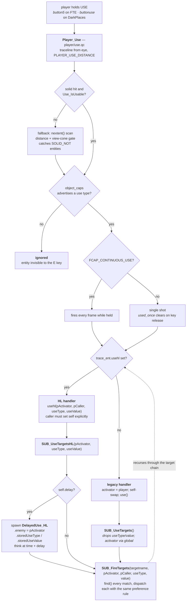

# 04 — Use dispatch: `.use` vs `.usehl`

This is the single most-stepped-on pattern in the server code. There are **two
parallel Use-callback fields on every entity**, and mixing them silently drops
the activator chain.

| | `.use` | `.usehl` |
| --- | --- | --- |
| Signature | `void()` | `void(entity pActivator, entity pCaller, float useType, float useValue)` |
| Activator | global `activator` | `pActivator` parameter |
| `self` | swapped by the call site | **not** swapped — the caller must do it |
| Use type / value | lost | carried in parameters |
| Declared in | `src/progsdefs.qc` — a stock Quake **system field**, above `end_sys_fields`, so it can never be renamed | `src/gamedefs.qc` |

**The dispatch-preference rule: every call site prefers `.usehl` if set, and
falls back to `.use` otherwise.** That is what makes migration incremental — add
the HL handler next to the legacy one and the HL path wins automatically.

## The full path from key press to fired targets



## `object_caps` — without it, USE does nothing

`Player_Use` only fires entities whose `object_caps` advertises a use type. This
is the most common reason a freshly written entity "doesn't respond to E".

| Flag | Value | Behaviour |
| --- | --- | --- |
| `FCAP_IMPULSE_USE` | `0x08` | single shot; `used_once` clears on key release. Doors, buttons, USE-on-NPC. |
| `FCAP_ONOFF_USE` | `0x20` | same dispatch path as impulse here. HL distinguished them for the engine; this project does not. |
| `FCAP_CONTINUOUS_USE` | `0x10` | fires while the button is held. Chargers (`func_chargers.qc`). |

Set it in the spawn function, right next to the handler:

```c
self.usehl       = Foo_UseHL;
self.object_caps = FCAP_IMPULSE_USE;
```

Other `FCAP_*` values in `gamedefs.qc` (`FCAP_ACROSS_TRANSITION`,
`FCAP_MUST_SPAWN`, `FCAP_DIRECTIONAL_USE`, `FCAP_MASTER`, `FCAP_DONT_SAVE`) are
map-engine concerns, not Use dispatch.

## Use types

`USE_OFF`, `USE_ON`, `USE_SET`, `USE_TOGGLE` — in `gamedefs.qc`. Only the
`.usehl` path carries them. A legacy handler that calls `SUB_UseTargets()`
throws them away, along with the activator chain, which is why the two styles
must never be mixed inside one entity.

## Rules

- **Never mix.** An HL handler calling legacy `SUB_UseTargets()` silently loses
  activator chain state. Symptom: a `trigger_counter` or `multi_manager`
  downstream credits the wrong player, or a `trigger_changelevel` fires with
  `world` as the activator and takes nobody with it.
- **Disarm with the right value.** `SUB_Null` is `void() SUB_Null = {};` in
  `subs.qc` and is assignable to any zero-argument function field. For `.usehl`
  use the fteqcc literal `__NULL__` — `SUB_Null` has the wrong signature.
- **Set `self` yourself.** Calling `trace_ent.usehl(...)` does *not* make
  `self = trace_ent`. The handler will run against whatever `self` already was.
  `SUB_FireTargets` does the swap for you; hand-rolled call sites must too.

## Migrating an entity

1. Add the HL handler alongside the existing one.
2. Wire `self.usehl = Foo_UseHL;` at the same place `self.use = Foo_Use;` is set.
3. Leave `.use` in place as a transitional fallback.

The preference rule means the HL path wins from that moment, and the legacy
handler stays as a safety net for any call site not yet converted.

## The only two canonical dispatch sites

- `src/serverqc/player/use.qc` — `Player_Use`, traceline plus `FCAP_*` gates
- `src/serverqc/subs.qc` — `SUB_FireTargets(targetName, pActivator, pCaller, useType, value)`

If you find yourself writing a third, prefer routing through `SUB_FireTargets`.

---

Previous: [03 — Entities](03-entities.md) · Next: [05 — Damage](05-damage.md)
