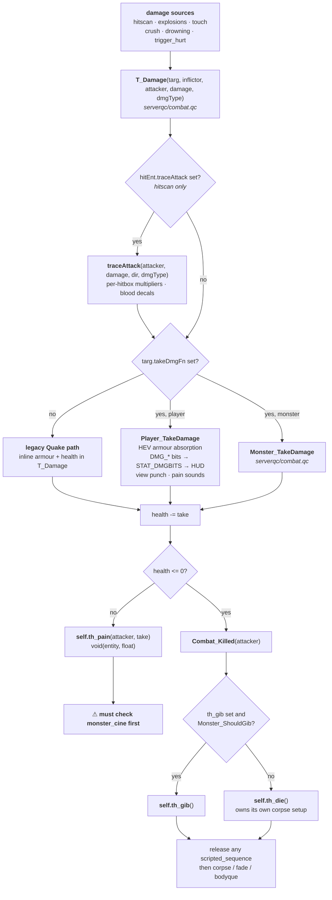

# 05 — Damage, pain, and death

All damage enters through one function and leaves through one of three exits:
pain, death, or gibs. The pipeline is **polymorphic by opt-in** — an entity that
sets `.takeDmgFn` gets the Half-Life handling; one that does not falls through to
the legacy Quake body.

## The pipeline



## Opting in

```c
Monster_InitTakeDamage();   // monster_base.qc
```

sets three things at once:

```c
self.takedamage  = DAMAGE_AIM;
self.takeDmgFn   = Monster_TakeDamage;
self.traceAttack = Monster_TraceAttack;
```

**Omit it and damage still "works"** — it just runs the legacy inline path, so
per-hitbox multipliers, blood colour, and gib thresholds are all skipped. The
monster takes flat damage and dies without the HL behaviour. Nothing warns you.

## `th_pain` and the `monster_cine` gate

`th_pain` is not a scheduled think. `T_Damage` / `Monster_TakeDamage` call it
**unconditionally, the instant damage lands**, bypassing whatever yield logic
the monster's think chain has.

Every other monster state function follows the convention:

```c
if (self.monster_cine && self.monster_cine != world)
    return;                 // a scripted_sequence owns us; don't touch frame/think
```

`th_pain` needs the same check, and it needs it **first, before any frame or
think mutation**. Without it, pain force-sets a flinch frame and reassigns
`self.think`, stomping the script's control — a visible pose glitch, and the
monster can be stranded off-script if the reassigned think does not itself yield.

Letting the pain *sound* play through is fine; it is the frame and think
assignment that must be gated.

```c
void Barney_Pain(entity attacker, float damage)
{
    if (self.monster_cine && self.monster_cine != world)
        return;                          // <- first, before anything else
    sound(self, CHAN_VOICE, ..., 1, ATTN_NORM);
    self.frame = FLINCH_START;
    self.think = Barney_PainThink;
    self.nextthink = time + 0.1;
}
```

A monster with no scripted-sequence support at all — `alien_slave`, `headcrab`,
`houndeye`, `bullchicken`, `barnacle` — does not need the check, since nothing
ever sets `monster_cine` on it.

## Death

`Combat_Killed` calls `self.th_die`. **`th_die` owns its own corpse setup** —
there is no default fall-to-corpse behaviour to rely on.

A `th_die` on a monster that participates in scripted sequences must release the
script before doing anything else:

```c
void Barney_Die()
{
    if (self.monster_cine && self.monster_cine != world)
    {
        entity c = self.monster_cine, s = self;
        self = c;  ScriptedSeq_CancelScript();  self = s;
    }
    // ... corpse setup
}
```

## Utilities

| Call | Notes |
| --- | --- |
| `T_Damage(targ, inflictor, attacker, damage, dmgType)` | the only entry point; `dmgType` defaults to 0 |
| `T_RadiusDamage(...)` | explosions; falls off with distance, traces for cover |
| `T_Heal(e, amount, ignoreMax)` | caps at `max_health` unless `ignoreMax` |
| `Gib_ShouldGib()` | damage-threshold test |
| `Gib()` | spawn gibs and remove the monster |
| `Blood_SpawnImpact(org, dir, color, amount)` | `monster_bloodColor` picks red vs yellow |

`inflictor` is the thing that physically did it (the rocket); `attacker` is who
gets the credit (the player who fired it). Obituaries read `attacker`.

---

Previous: [04 — Use dispatch](04-use-dispatch.md) · Next: [06 — Monsters](06-monsters.md)

## Hit locations

`Combat_TraceAttack` runs every damaging trace through `Combat_DetectHitbox`,
which reads the impact height against the target's hitbox: the top 13 units are
a head (×1.7 damage), everything below 30 units from the top is legs (×0.7), and
the rest is the body. It also records the zone in `.hitbox`, which the zombie
reads, and stamps `.hitbox_time` with the frame. The stamp is what lets the kill
feed tell a headshot from a stale zone, since an explosion sets no zone at all.

Until this was wired up the function had no caller anywhere, so every shot did
body damage wherever it landed.

## Never damage while walking `.chain`

`findradius` links its results through `.chain`, and a player death rebuilds
`.chain` for every client (the scoreboard walks them with `findchainflags`). A
loop that damages while stepping `e = e.chain` therefore continues into every
client on the map; saving the next link first does not help, because that
entity's own link was rewritten too. Spawn telefrag killed everyone this way.

`Chain_Freeze` (`serverqc/subs.qc`) copies a search into `.dmg_chain` before
anything takes damage:

```c
for (entity e = Chain_Freeze(findradius(org, r)); e; e = e.dmg_chain)
```

Used by `T_RadiusDamage` and by spawn telefrag. Any new radius damage loop must
do the same.
