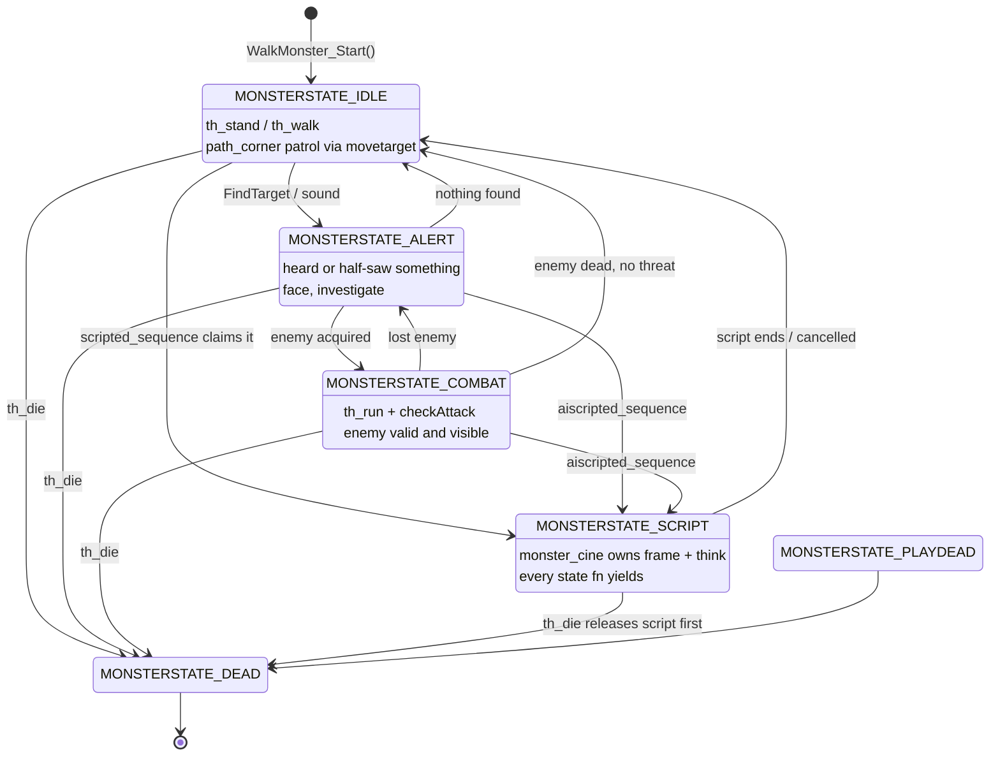
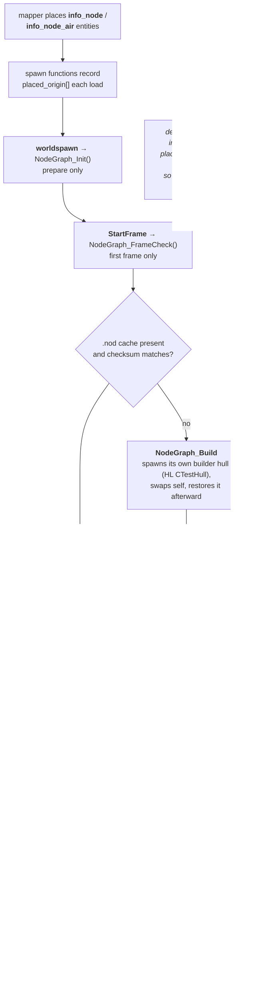

# 06 — Monsters and AI

Monsters keep the standard Quake shape — `th_stand` / `th_walk` / `th_run` /
`th_pain` / `th_die` function fields driven by per-entity thinks — with
Half-Life's state machine, scripted sequences, and node navigation layered on.

## Monster states



`SF_MONSTER_PRISONER` monsters never acquire targets. Note that only the shared
`ai.qc` `FindTarget` honours it — bespoke monster AIs such as the human grunt
needed their own gate.

## Spawn checklist

1. `setmodel(self, MODEL); setsize(self, MIN, MAX);`
2. `self.solid = SOLID_SLIDEBOX; self.movetype = MOVETYPE_STEP;`
3. `self.flags |= FL_MONSTER;` — or let `WalkMonster_StartGo` set it.
4. `self.health`, `self.view_ofs`, `self.yaw_speed`, `self.monster_bloodColor`,
   `self.monster_fieldOfView`.
5. Hooks: `th_stand`, `th_walk`, `th_run`, `th_pain` (`void(entity, float)`),
   `th_die`, optional `sightSound`, `checkAttack`.
6. `Monster_InitTakeDamage()` — required, see [05 — Damage](05-damage.md).
7. `self.frameByName = Foo_FrameByName;` — needed for DarkPlaces framegroup
   name resolution.
8. `WalkMonster_Start()` (or `FlyMonster_Start` / `SwimMonster_Start`) —
   droptofloor, `FL_MONSTER`, schedules the first `th_stand`, installs a
   `path_corner` movetarget if `self.target` is set, and wires `Monster_Use` /
   `Monster_UseHL`.

> **Friendly USE (talkmonsters):** do **not** call `WalkMonster_Start()`. Its
> scheduled go-think clobbers a `usehl` override. Write a custom `Foo_StartGo`
> that mirrors `WalkMonster_StartGo` but installs your own callback.

## Movement

| Call | When |
| --- | --- |
| `movetogoal(dist)` | engine pathing; needs `self.goalentity`. Handles obstacle avoidance and step-up. |
| `walkmove(yaw, dist)` | direct step in a yaw direction. Lower level — use for manual steering such as flee. |
| `AI_Stand()` / `AI_Walk(dist)` / `AI_Run(dist)` | bundle `FindTarget` + `movetogoal`. `AI_Run` is combat-oriented and calls `checkAttack`. Friendly NPCs should roll their own follow think. |

**`MOVETYPE_STEP` ignores `velocity` for horizontal motion.** Setting
`mon.velocity_x` does nothing visible. Use `walkmove` or `movetogoal`.

**`yaw_speed` needs conversion.** Half-Life's is degrees-per-second ×2 and
time-based; the Quake builtin applies it per call, making it ~5× faster. Use the
`YAW_HL()` macro from `monster_base.qc` when porting an HL value.

## Animation

`Monster_PlayAnimByName(mon, name)` is the single source of truth. It resolves
via `frameforname` on FTE and via the monster's own `.frameByName` resolver on
DarkPlaces, and returns the duration in seconds.

- **Looping** animations (idle, walk): call once on state entry and check
  `self.frame` to avoid restarting the cycle every think.
- **One-shots** (flinch, die): use the returned duration to schedule the
  follow-up think.

The `.framegroups` file beside the IQM lists `start length fps loop name` per
group. **Without the name column `frameforname` returns −1** and every animation
silently falls back to frame 0.

## Voice

```c
Sentences_Play(self, CHAN_VOICE, "SC_HELLO", 1.0, ATTN_NORM, 100);
```

picks a random variant from the sentences.txt group, and returns `FALSE` if the
group is missing. Groups are loaded at `worldspawn`.

Monsters driven by `scripted_sentence` install
`self.playScriptedSentence = Foo_PlayScriptedSentence;` in their spawn —
signature `float(string sentence, float duration, float volume, float attn,
float concurrent, entity listener)`.

## Cooperating with `scripted_sequence`

Every think state must yield while a script owns the monster:

```c
if (self.monster_cine && self.monster_cine != world)
    return;
```

`th_pain` needs the same gate and it is easy to miss, because pain is not a
scheduled think — see [05 — Damage](05-damage.md). `th_die` must *release* the
script rather than yield to it.

## The `info_node` navigation graph

Half-Life's node graph, ported with the pathfinding but not the performance
machinery.



QuakeC has no structs, pointers, or `malloc`, so HL's `CNode`/`CLink` become
parallel global arrays — the same idiom as `sentences.qc` and `titles.qc`.

HL's performance machinery (compressed Floyd-Warshall routing tables) is
**deliberately skipped**. It exists to make 1024-node graphs cheap to query
thousands of times per second; for TC maps — tens to low hundreds of nodes,
infrequent queries — on-demand Dijkstra plus a linear nearest-node scan is
plenty.

The human grunt has a bespoke AI and does not use the shared route hooks.

---

Previous: [05 — Damage](05-damage.md) · Next: [07 — Weapons](07-weapons.md)
