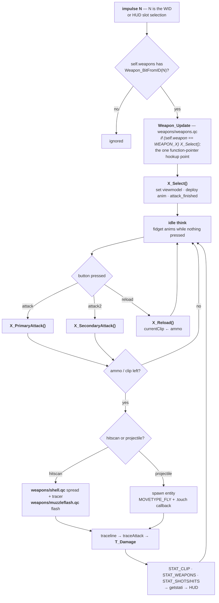

# 07 — Weapons

All per-weapon metadata lives in `src/weapondefs.qc` and is initialised twice —
once from `worldspawn` on the server, once from `CSQC_Init` on the client. Both
VMs need their own copy because the HUD draws from the same table the server
arms from.

## Two identifier spaces

This is the thing to get right. They are not interchangeable.

| | `WID_*` | `WEAPON_*` |
| --- | --- | --- |
| Kind | small integer ID, `1 .. WID_COUNT-1` | 32-bit **bitflag** |
| Declared in | `src/weapondefs.qc` | `src/gamedefs.qc` |
| Also used as | the impulse number — `impulse 3` ≡ `WID_PYTHON` | on-the-wire format for `STAT_WEAPONS` and `self.weapon` |
| Array index | yes — `weapon_slot[WID_MP5]` | no |

Convert with `Weapon_BitFromID(id)` and `Weapon_IDFromBit(bit)`. Never assume
`WID_n` and the nth bit correspond — they do not. The full generated table is at
[reference/weapons.md](../reference/weapons.md); note for example that
`WID_SHOTGUN` is 5 while `WEAPON_SHOTGUN` is 64, and `WEAPON_CYCLER` is an alias
for the otherwise-unused `WEAPON_CHAINGUN` bit.

`WEAPON_SUIT` (32768) rides in the same field: the HEV suit is a "weapon" bit.

## The registry

Parallel arrays indexed by WID — one source of truth, replacing the per-file
hardcoded tables that used to drift:

```c
float  weapon_slot      [WID_COUNT];   // 1-based slot (matches the number key)
float  weapon_pos       [WID_COUNT];   // 0-based row within the slot
float  weapon_bit       [WID_COUNT];   // matching WEAPON_* bitflag
string weapon_sprite    [WID_COUNT];   // HUD icon path, no extension
string weapon_ammo      [WID_COUNT];
string weapon_ammo2     [WID_COUNT];
string weapon_name      [WID_COUNT];   // human-readable
float  weapon_crosshair [WID_COUNT];   // gfx/crosshairN.png, -1 = none
var void() weapon_select_func[WID_COUNT];
```

**Adding a weapon:** bump `WID_COUNT`, add the `#define WID_FOO`, add an init
block in `Weapon_RegistryInit()`, and reuse or add a `WEAPON_*` bit. Do not
reintroduce a per-file table.

## The attack cycle



## Per-weapon implementation

One file per weapon under `src/serverqc/weapons/` — `crowbar.qc`, `glock.qc`,
`mp5.qc`, `python.qc`, `shotgun.qc`, `crossbow.qc`, `handgrenade.qc`, `rpg.qc`,
`satchel.qc`, `tripmine.qc`, `gauss.qc`, `egon.qc`, `hornetgun.qc`, `snark.qc`.

Each defines:

- `<Name>_Select()` — animation set plus arm
- one or more of `<Name>_PrimaryAttack()`, `<Name>_SecondaryAttack()`, `<Name>_Reload()`
- an idle think

and is hooked from `Weapon_Update()` in `weapons/weapons.qc`:

```c
if (self.weapon == WEAPON_MP5) MP5_Select();
```

**Keep that `if` chain.** It is intentionally left as the one function-pointer
hookup point rather than folded into a table.

The ALLCAPS weapon prefixes (`MP5_`, `SHOTGUN_`, `RPG_`, …) are grandfathered
and deliberate — do not "fix" them to `Mp5_`.

## Mid-animation actions need a time latch

A melee swing or grenade throw lands its damage partway through the animation.
Testing for a float window between ticks (`if (t > 0.4 && t < 0.5)`) is a bug:
the frame interval is variable, so the window is sometimes skipped entirely
(no hit) and sometimes hit twice.

Use a **latch** — a timestamp recording when the action is due, cleared once it
fires. This was the fix for both the grunt and assassin melee "stuck / no hit"
bug, and the same shape applies to player weapons.

## Ammo and pickups

`items/weaponbox.qc` handles dropped-weapon boxes; `items/items.qc` handles
world pickups. In cooperative play each unclaimed item gets a **private
per-client copy** (`items/coopitem.qc`) so two players can both take the same
crate — `CoopItem_RefreshFor(client)` builds them at spawn, and
`CoopItem_RemoveGhostsFor(client)` cleans up on disconnect.


## Third person weapon effects

A weapon's flash, casing and smoke are placed off the **viewmodel**, which only
the shooter sees. Everyone else used to get the same entities at the same
positions, so casings fell out of the shooter's eye and the flash was nothing but
the `EF_MUZZLEFLASH` light glowing at the body centre.

Each effect now exists twice, split by `customizeentityforclient` (honoured by
both engines for entities that are not CSQC networked):

| copy | placed off | drawn to |
| --- | --- | --- |
| first person | the viewmodel offset the weapon passes in | the shooter only: `viewmodelforclient` for the flash, `Effect_OnlyToOwner` for the casing |
| third person | the world weapon in the hand, `.weapon_ent` | everyone but the shooter: `Effect_HideFromOwner` |

`Weapon_WorldMuzzle(p)` (`weapons/shell.qc`) resolves the third person anchors
into `g_fxMuzzle` and `g_fxEject`. The world weapon's origin *is* the grip, since
`Player_WeaponModelSync` attaches it to `Bip01 R Hand`, so the muzzle is the grip
pushed along the holder's aim by the model's longest extent. World models do not
agree on which axis is the barrel (`w_9mmar` lies along Y), which is why the
extent is taken over both horizontal axes rather than assumed. Where the model has
a `wpn_silencer` bone, the suppressor mount at the barrel end, the tag position is
used instead. The ejection port is a third of the way along, up and to the right.

The third person flash is spawned once per shot by `Weapon_MuzzleflashWorld`, a
hook at the end of `Weapon_Attack` keyed off `EF_MUZZLEFLASH`, rather than from
`Weapon_Muzzleflash`. Scoped weapons skip the first person sprite while aimed so
the scope is not whited out, and observers must still see those shots.

Only the third person casing makes the bounce sound. A sound plays at a position
whether or not its entity is sent to a client, so a sounding first person copy
would be heard as a second casing by every player nearby.

Monsters with the gun baked into their mesh call `Monster_MuzzleEffects`, which
anchors to the right hand bone and draws to everyone: the Half-Life grunt (MP5,
shotgun, and a flash with no casing for the grenade launcher), Barney, and any
monster a downstream gamedir adds. Each passes its own hand-to-muzzle length
and casing model, and
precaches that casing itself rather than relying on a player weapon having done so.

**Muzzle smoke is still first person positioned.** `pointparticles` is a broadcast
with no per client form, so the smoke cannot be split the same way.

---

Previous: [06 — Monsters](06-monsters.md) · Next: [08 — Player](08-player.md)
