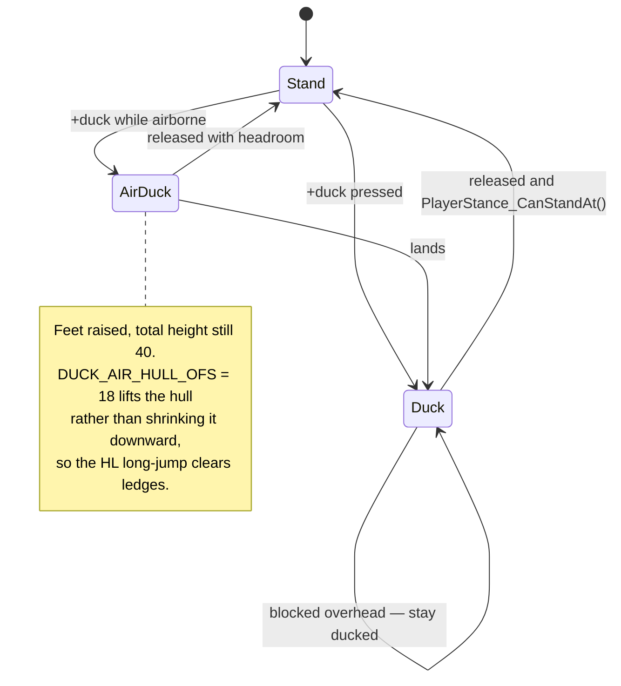

# 08 — The player

## Hulls: two games, two body sizes

Half-Life's player is 68 units tall; Quake's is 56. The project ships both map
families, so the hull is chosen per map at `worldspawn` by `PlayerProps_Init()`
and stored in `var` globals that the rest of the code reads.

| | Half-Life maps | id1 maps |
| --- | --- | --- |
| `PLAYER_STAND_SIZE_MIN/MAX` | `'-16 -16 -24'` … `'16 16 44'` (68 tall) | `VEC_HULL_MIN/MAX` = `'-16 -16 -24'` … `'16 16 32'` (56 tall) |
| `PLAYER_DUCK_SIZE_MIN/MAX` | `'-16 -16 -24'` … `'16 16 16'` (40 tall) | |
| `STAND_VIEW_OFS` | `'0 0 42'` | lowered to match |
| `DUCK_VIEW_OFS` | `'0 0 12'` | |

There is a second, separate pair — `HL_PLAYER_STAND_SIZE_MIN/MAX` =
`'-16 -16 -36'` … `'16 16 36'`. That is the **true Half-Life physics hull, with
the origin at hip height rather than at the feet**. `player.iqm` and `holo.iqm`
were authored to it, so any code that *positions those models* — as opposed to
driving the live player controller — must use this pair. Use the wrong one and
`droptofloor()` sinks the model about 12 units into the floor, because the bbox
bottom lands 12 units above the mesh's actual feet.

> **BSP clipnode hulls.** Quake BSP collision snaps a tracebox to one of the
> map's precompiled hulls, not to arbitrary box dimensions. A hull size that
> does not correspond to a compiled clipnode hull will behave as the nearest one
> — which is why these constants are not free parameters.

## Stance

`serverqc/player/stance.qc`. Three states, plus an air-duck special case.



`PlayerStance_TryStand` will not un-duck into geometry — it traceboxes the stand
hull first (`PlayerStance_HullFits`) and stays crouched if blocked. Stamina
(`PLAYER_STAMINA_DECREASE` / `PLAYER_STAMINA_REGEN`) gates sprinting.

## The split body model

The player renders as a torso that aims where the view points and legs that
animate to the movement direction. The two engines get there differently:

| | FTE | DarkPlaces / Zircon |
| --- | --- | --- |
| Mechanism | one entity, **dual skeleton** via `basebone` | **two entities** — legs on the player, torso as a child |
| Torso frames | bones ≥ `basebone` play `self.frame` | child entity plays its own frame |
| Leg frames | bones < `basebone` play `self.baseframe` | player entity plays `self.frame` |
| Model set | `PLAYER_MODEL_FULL` | `PLAYER_MODEL_LEGS` + `PLAYER_MODEL_TORSO` |

`Player_UseSplitBody()` picks the path. On the two-entity path
`Player_TorsoEnsure(p)` creates the child, `Player_TorsoAlignSpine(p)` and
`Player_TorsoSync(p)` keep it glued to the spine bone each frame, and
`Player_TorsoRemove(p)` must be called on disconnect or the child is orphaned.

The split point comes from a `splitbone` sidecar file beside the model.

### The upper body hitbox

On the two-entity path the torso child is resolved at draw time and by
`gettaginfo`, but it is never linked into the world at its drawn position, so it
cannot collide with anything. Player bullets trace with `MOVE_HITMODEL_4`, which
impacts a model's **mesh** rather than its bounding box, and once an entity has a
mesh the hull is not consulted. The player entity carries only the legs mesh, so
every shot above the waist passed straight through: chest and head shots did not
register.

`Player_HitboxSync(p)`, called from `Player_TorsoSync` every frame, keeps a
`player_hitbox` proxy over the upper body of each live player. Three properties
carry it:

- **`SOLID_CORPSE`.** A traceline whose ignore entity is `SOLID_SLIDEBOX` skips
  `SOLID_CORPSE`, so monster sight lines, `Player_Use` and movement behave as if
  the proxy were not there. A shooter that switches itself to `SOLID_BBOX` for the
  trace does hit it, and `Weapon_FireShot` already makes that switch so bullets
  can hit corpses.
- **No model, no `takedamage`.** Without a mesh, `MOVE_HITMODEL_4` falls back to
  the proxy's box, which is the point. Without `takedamage` it stays out of
  `T_RadiusDamage`'s `findradius` sweep, where it would double every explosion.
- **Strictly inside the player hull**, one unit in on every face but the waist.
  Hull traces (`MOVE_NORMAL_0`) and moving projectiles clip the player against its
  hull, so the player is always the nearer impact. Only the mesh trace, which
  finds nothing above the legs, reaches the proxy. A shared plane would tie, and a
  tie resolves by edict order.

The hull argument fails for the shooter's **own** projectiles: the engine skips a
projectile against its owner's hull, so the proxy is the first thing it meets, and
a rocket spawned at eye height starts inside it and explodes on its first move.
The engine skips owner against owned, never two entities with the same owner. The
proxy therefore carries a per-player `clipgroup` (`DP_RM_CLIPGROUP`), and every
player projectile calls `Player_ProjectileClip(proj, creator)` to join it. A new
projectile weapon must do the same.

**`Player_HitboxResolve()` must follow any traceline meant to hit people** that
can reach the proxy, which means one using `MOVE_HITMODEL_4`. It rewrites
`trace_ent` to the owner and deliberately leaves `trace_endpos` alone, since that
is the real impact point `Combat_DetectHitbox` measures head and leg shots from.
Skip it and `Combat_TraceAttack` takes its `SOLID_CORPSE` branch on the proxy:
it subtracts health from an invisible box and gibs it.

FTE keeps the whole body on one entity, so the proxy is never built there.

> **Known trap.** Adjusting the bind pose and the animation by equal and
> opposite offsets looks like it fixes alignment but cancels out — it changes
> nothing at runtime while appearing to be a real fix. Verify against the
> rendered result, not the numbers.

## Nametags

Other players' names are drawn just above their heads in every multiplayer mode.
A **teammate** is named whenever there is line of sight; an **enemy** only while
the crosshair is on them, so a tag never gives away an enemy you have not found.

Players are not CSQC entities in this project: they reach the client through
`MASK_ENGINE`, and nothing is networked for them. So the tag is built from two
halves.

**The server says who may carry a tag.** `serverqc/nametag.qc` rebuilds a roster
five times a second and broadcasts it only when it changes, over the same
`stuffcmd` console command channel as `sbrow` and `obit`:

```
ntag <roster>      one character per slot: '-' none, '0' no side, '1'..'9' a side
```

The client cannot work this out alone. An observer keeps `health` 666 and
`DEAD_NO`, and a corpse still has a model, so "who is alive" has to come from the
server. The side is the stock `.team` field, the one `combat.qc` already reads for
friendly fire; coop and survival treat everyone as one side. Two players are
friendly when their characters match and are not `0`. A freshly loaded CSQC gets
the roster from `cmd sbsync`.

**The client finds and draws them.** `clientqc/hud/hud_nametags.qc` reads each
slot's interpolated origin with `getentity(slot + 1, E_ORIGIN)`, projects the
head with `cs_project`, tests line of sight with `MOVE_NOMONSTERS` (so a closed
door hides a tag), and for an enemy also requires the projected point to sit near
the screen centre. Text shrinks and fades between `NAMETAG_FULL_DIST` and
`NAMETAG_MAX_DIST`.

> **The getentity gate.** Calling builtin 504 on an engine that lacks it kills
> the VM rather than returning zero. Zircon advertises `ZIRCON_GETENTITY_1`; FTE
> has the builtin in CSQC with the same field numbers but no extension string to
> test. `Nametag_HasGetEntity` therefore accepts `IsFTE()` or that string, and on
> any other engine draws nothing.

Two known limits: the client cannot see another player's stance, so a crouching
player's tag sits a little high; and the head height uses the client's copy of
the Half-Life hull, which `PlayerProps_Init` only lowers on the server, so on id1
maps tags also sit slightly high.

## Spawn and respawn

`PutClientInServer` in `serverqc/client.qc` rebuilds the player from scratch on
every life. Because the client edict is **reused**, anything not explicitly
cleared survives into the next life. The ones that have actually caused bugs:

```c
self.armorvalue = 0;                  // or armour carries over into the next life
self.armortype  = 0;
self.flashlight_battery = 99;
self.flashlight_on = 0;
self.player_longJump = FALSE;
self.dmg_shownhud_bits = 0;
Player_FrictionRelease();             // stale func_friction from the previous life
```

Inventory follows the mode:

- **Multiplayer respawn** — `Loadout_ClearInventory()`, then the per-mode loadout.
- **Transfer arrival** — `PlayerTransfer_Load()` restores what was staged.
- **Hub restore** — left alone; the engine snapshot already has it.

`WEAPON_SUIT` is granted automatically on id1 maps (there is no HEV suit pickup
in Quake) and when `g_startwithsuit` is set.

## Player subsystems

| File | Owns |
| --- | --- |
| `player/use.qc` | `Player_Use` — see [04](04-use-dispatch.md) |
| `player/stance.qc` | crouch, sprint, stamina, air-duck |
| `player/swim.qc`, `jump.qc` | water movement, long jump |
| `player/footsteps.qc` | surface-typed step sounds |
| `player/geiger.qc` | radiation proximity clicks (`geiger_range`) |
| `player/torso.qc`, `animation.qc` | split body, anim state |
| `player/transfer.qc` | per-slot cross-map inventory — see [09](09-persistence.md) |
| `player/spawnpoint.qc` | `SelectSpawnPoint`, coop/DM spawn selection |
| `player/death.qc` | `Player_Die`, death camera, restore pointer |
| `player/movefix.qc` | engine movement corrections |

## Viewmodel sway

DarkPlaces gives the first-person weapon four motions the engine computes
itself: `cl_bobmodel_side` and `cl_bobmodel_up` (a figure-eight tied to the
stride), `cl_followmodel` (the gun's position lagging behind the view) and
`cl_leanmodel` (its angles lagging behind). Zircon has all four. FTE has the
bob and neither lag: its `cl_followmodel` and `cl_leanmodel` are a pair of
FIXME comments in `client/view.c`, not cvars.

Two things were in the way, and only one of them turned out to be real.

**The viewmodel entity is not an obstacle.** This game keeps the engine's own
viewent empty and draws the weapon as a server entity carrying
`.viewmodelforclient`. Both engines pick the gun-bob transform on a render flag
rather than on "is this the classic viewent", so that entity is already
eligible: Zircon maps `RENDER_VIEWMODEL` to `viewmodelmatrix_withbob`, and FTE
maps the same wire flag to `RF_WEAPONMODEL` and then to `weaponmatrix_bob`. The
one opt-out is `EF_NOGUNBOB` (256) in the entity's `.effects`, and the viewmodel
sets only `EF_NOSHADOW` (4096).

**`cl_bobmodel` was simply never switched on.** FTE defaults it to 0 where
Zircon defaults it to 1, and `default.cfg` set `_side` and `_up` without it, so
the whole bob was off on one engine. That is a config line, not code.

The lag is genuinely absent from FTE, so `serverqc/player/viewsway.qc` computes
it and the viewmodel pose adds it. `IsFTE()` gates the whole thing, because
running it on Zircon would double the engine's own.

### Why the filter chain looks like that

It is DarkPlaces', kept step for step so the two engines feel the same rather
than merely both moving. Each frame:

1. **Highpass the view origin and angles.** What survives a highpass of a
   position is roughly its velocity, which is what the gun should lag against.
   The highpass is `value - lowpass(value)`, with the lowpass limited so a long
   frame cannot leave the state arbitrarily far behind.
2. **Scale by the four `*_speed` cvars, negated**, so the gun moves against the
   view rather than with it.
3. **Highpass, then lowpass, that result.** Applying the pair again turns the
   velocity from step 1 into something like acceleration, which is what makes
   the motion settle instead of tracking. The lowpass runs last so its own state
   *is* the output.

Three details carry more weight than they look:

- **The highpass state is stored relative to the previous frame's value**, not
  absolutely, and the angle version wraps that state to the multiple of 360
  nearest the input. Wrapping to [-180,180] about zero instead makes a
  continuous spin lurch once per revolution.
- **The angle axes are not in the origin's axis order.** The *up* filter pair
  goes on pitch and the *side* pair on yaw. Swapping them produces motion that
  looks plausible and is wrong.
- **The rates are multiplied by frametime**, so the largest of them (60) makes
  its blend factor saturate at 1 once a frame exceeds 1/60 s. Below about 60 fps
  the vertical follow weakens markedly. DarkPlaces degrades identically; this is
  faithful rather than a defect.

### The two conversions at the end

The maths runs in world space and view-convention angles. The viewmodel wants
neither.

`vm.origin` is read in **view space**, so the world delta is projected onto the
view basis, and the Y component is negated: the engine inverts the weapon
matrix's right vector, so the model's local +Y is view *left*. `vm.angles` are
entity render angles, whose pitch sign is the opposite of the view convention
the filters worked in, the same flip `Viewmodel_Kick` already applies to
punchangle. Both conversions happen once, in `Viewsway_Step`, and the outputs
are stored ready to add, so no call site repeats them.

### One writer

`Player_UpdateViewmodelPose` has four exits and three of them write the pose.
Each also advances the recoil spring, so the chain already depended on exactly
one branch running per frame. The sway advances eight filters and needs the same
guarantee, so `Viewsway_Step` is called once ahead of the branch chain and all
three writing branches go through `Viewmodel_Commit`, which is now the only
place `vm.origin` and `vm.angles` are assigned.

Any frame where the weapon is hidden (dead, intermission, mind-grabbed,
observer) returns before the pose runs, so the filters would otherwise resume
against a stale position. `Viewsway_Reset` clears the previous-frame values,
which marks the filters unseeded, and the next visible frame reseeds from the
live view and emits nothing.

## Friction is a global

`func_friction` modifies the **global** `sv_friction` on touch and restores it
when the player stops touching. That means a player who dies, disconnects, or
changes level inside the volume would leave the global modified for everyone —
hence `Player_FrictionRelease()` in both `PutClientInServer` and
`ClientDisconnect`.

---

Previous: [07 — Weapons](07-weapons.md) · Next: [09 — Persistence](09-persistence.md)

## Corpses and what a respawn must clear

`Player_BodyQueue` is the single entry point for queueing a body. It refuses a
player who is still alive, one whose body was already handed over by
`Player_DeathThink`, and a gibbed one (`EF_NODRAW`, which the copy does not
carry, so a gib used to leave a whole corpse). It forces a death animation when
the frame is anything else, because the queue plays the frame it is handed and a
jump frame stands upright. `Player_CopyCorpse` then sets the copy to
`MOVETYPE_TOSS` with no sideways speed, or a body copied in a walking movetype
slides across the floor.

Bots press no button, so they respawn `PLAYER_BOT_RESPAWN_DELAY` seconds after
`Player_Die` rather than on the third frame of their death, which used to queue
a body still in the air.

A reload finishes through the player's think and dying replaces that think, so
`Player_Die` cancels the delayed reload sound and clears `.reload`, and
`Loadout_ClearInventory` clears `.reload`, `.blockSwitch` and `.weaponframe` on
the way back in. Without the frame reset the viewmodel replays the reload after
respawn, since the gun is re-selected without playing its draw.
