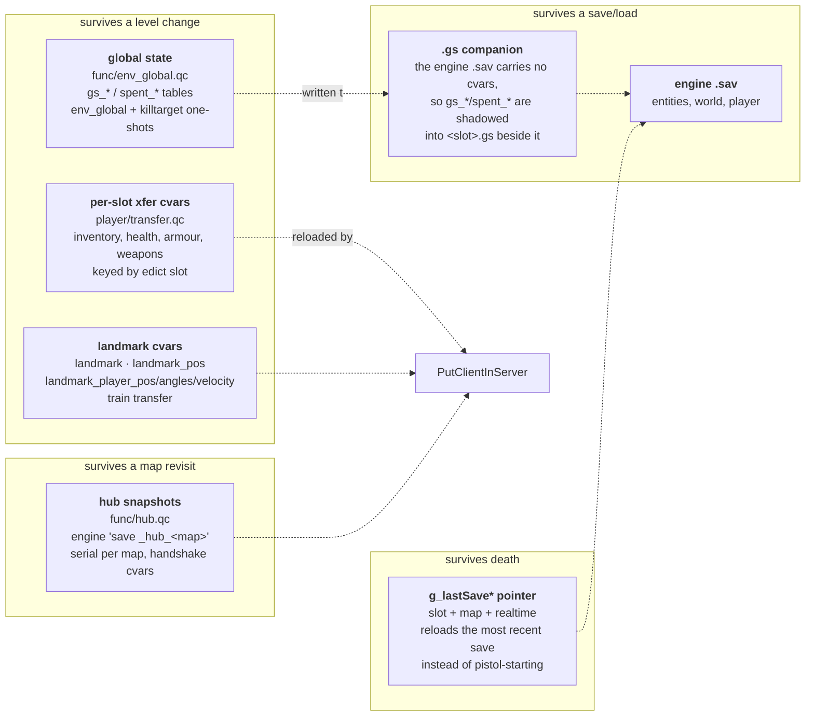
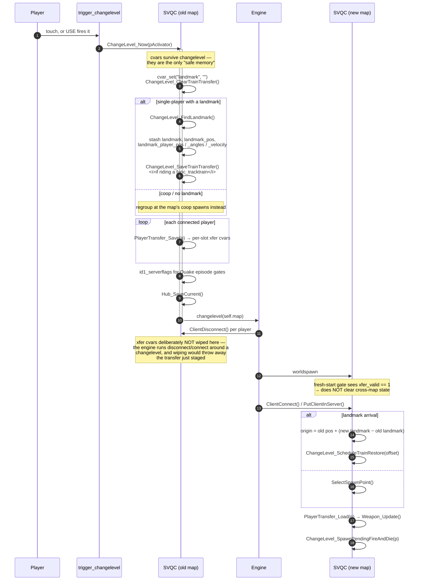

# 09 — Persistence: level changes, saves, and hubs

Half-Life expects state to survive a level change, a save/load, and a return
visit to a map you already cleared. Quake's engine offers almost none of that,
so this project layers **five separate mechanisms**, each owning a different
boundary. Confusing which one owns what is the usual source of bugs here.

## Who owns what

## Level change

### Why cvars

`changelevel` destroys every entity and reloads the progs. Cvars are the only
storage that survives it, so all cross-map state is encoded into cvar strings —
per-slot keys like `xfer_3_health`, built by `PlayerTransfer_Key(slot, name)`.
The slot is the player's edict index, which is why `Player_SlotIndex(p)` exists
and why coop transfers keep each player's own inventory apart.

### The `FireAndDie` relay

An entity in the *old* map may be targeted by the changelevel trigger. Its
target must fire in the *new* map. `ChangeLevel_StashFireAndDie(targetName,
delay)` stores it and `ChangeLevel_SpawnPendingFireAndDie(pActivator)` recreates
a one-shot relay after the new map's player is in, which fires and removes
itself.

## Global state — `env_global` and one-shot kills

`func/env_global.qc` keeps two tables in cvars:

- **`gs_*`** — HL's global entity state: named flags a mapper sets with
  `env_global` and reads back many maps later ("did the player already start the
  reactor?").
- **`spent_*`** — one-shot tracking. An entity `killtarget`ed or consumed stays
  removed when the player revisits the map. `Spent_StampMapLoad()` marks the
  current load so re-entry is distinguishable from a fresh start.

Because the engine's `.sav` does not carry cvars, saving must shadow both tables
into a `<slot>.gs` companion file next to the save. `Save_WriteGlobalCompanion`
in CSQC forwards the request to SVQC's `GlobalState_WriteCfg` on **every** save,
so a reused slot always has a matching companion.

## Hub snapshots

For a map you have already cleared and walk back into, the transfer cvars are
not enough — the world itself (opened doors, dead monsters, spent ammo) has to
come back. `func/hub.qc` uses the engine's own save system as a snapshot store:

- `Hub_SaveCurrent()` issues `save _hub_<map>` on the way out.
- `Hub_SerialFor(map)` / `Hub_SetIndex(map, serial)` keep a serial per map so
  repeated visits do not collide (hence the `_hub_<serial>_<map>.sav` files in
  `data/`).
- `Hub_WorldspawnArrivalCheck()` in `worldspawn` and `Hub_ConsumeArrival()` in
  `StartFrame` complete a two-phase handshake, because the snapshot restore
  finishes after `worldspawn` returns.
- `Hub_ArrivalFixup(p)` repositions the arriving player.

The whole path degrades gracefully: if no snapshot exists the map simply loads
fresh.

## Death restore

In single player, dying reloads the most recent save rather than restarting the
level from a pistol start. The pointer is three cvars — `g_lastSaveSlot`,
`g_lastSaveMap`, `g_lastSaveTime` — and it is written across all three VMs:

1. **CSQC** stamps it (`Save_StampPointer`) whenever a save is written or a
   load completes. `Save_ConsumePendingLoad` finishes the job on the first frame
   after a load, because `load` reloads the CSQC VM mid-flight.
2. **MENUQC** routes the menu's Load Game and quickload through the same cvars.
3. **SVQC** reads it in `Player_Respawn` and picks the load.

`g_deathRestart` is a one-shot flag consumed by the `worldspawn` fresh-start
gate, so a death restart does not get treated as a new game. Starting a New Game
wipes the pointer outright.

Quake 1 maps restart the level instead — id1 has no cross-level save semantics
to honour.

## Multiplayer notes

- Coop is capped (`mp_coop_maxplayers`, default 4); `ClientConnect` drops
  players past the cap and the Create Server menu clamps its slider to match.
- The scoreboard and obituary feed are their own `stuffcmd` channel, so a
  joining client gets `Scoreboard_SendAllTo` to catch up on everyone already
  present, plus its own row sent directly (the client chain may not include it
  yet that early).
- `PublishGameRulesTo(p)` overwrites the client's own `gamemode` / `coop` /
  `deathmatch` / `fraglimit` / `timelimit` cvars, because a remote client's
  copies are leftovers from whatever it last hosted.

---

Previous: [08 — Player](08-player.md) · Next: [10 — Client and HUD](10-client-hud.md)
