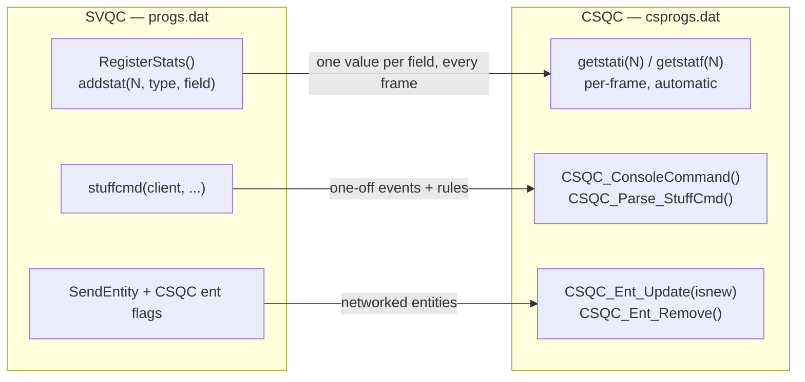

# 10 — Client and HUD (CSQC)

`data/csprogs.dat` runs on each client. It owns everything the player sees that
is not the world itself: the HUD, the view, weapon selection UI, camera
interpolation, and the client half of the save/load flow.

It cannot read server entity fields directly. Three channels carry data across.

## The three SVQC → CSQC channels



### Stats — the per-frame channel

`RegisterStats()` in `serverqc/main.qc` binds server fields to numbered slots
declared in `src/gamedefs.qc`. The client reads them with `getstati(N)`. This is
the cheap path: one value per field per frame, no message assembly.

| Stat | Field | Used for |
| --- | --- | --- |
| `STAT_TOTALITEMS` / `STAT_PICKED_ITEMS` | `item` / `picked_items` | pickup counter |
| `STAT_SHOTS` / `STAT_HITS` | `total_shots` / `total_hits` | accuracy readout |
| `STAT_INCROSS` | `incross` | crosshair "target under cursor" state |
| `STAT_CLIP` | `currentClip` | rounds in the magazine |
| `STAT_WEAPONS` | `weapons` | the `WEAPON_*` bitfield — drives the whole weapon-select UI |
| `STAT_FLASHBAT` / `STAT_FLASHLIGHT` | `flashlight_battery` / `flashlight_on` | HEV flashlight |
| `STAT_TRAIN` | `trainHudState` | `func_tracktrain` control overlay |
| `STAT_DMGBITS` | `dmg_shownhud_bits` | latched `DMG_*` bits → damage-type icons |

Adding a stat means a `float STAT_FOO = N;` in `gamedefs.qc` (shared, so both
sides agree) plus an `addstat` line. The numbers are an ABI — do not renumber.

### `stuffcmd` — the event channel

The server writes a console command into the client's command buffer.
`CSQC_ConsoleCommand` intercepts names the client owns. Used for things that
change rarely or fire once:

- game rules (`gamemode`, `coop`, `deathmatch`, `fraglimit`, `timelimit`) —
  written with `set` rather than a bare assignment so they land even if the
  stuffcmd beats the client's own cvar registration
- scoreboard rows and obituaries
- `scrfade` screen fades, `autosave`

> Routing a name through `CSQC_ConsoleCommand` is **required** for stuffcmd
> names that do not already exist as engine cvars or commands — `autosave`,
> fired by `trigger_autosave`, is one.

### `SendEntity` — networked entities

For things the client must interpolate rather than just read. Currently the
`trigger_camera` flythrough: the server marks the cam entity for CSQC transfer,
`CSQC_Ent_Update(isnew)` receives snapshots keyed by `ENT_CAMERA`, and the
client keeps one previous snapshot per cam and lerps between them so the view
glides between server ticks instead of stepping.

The lerp extrapolates at most 1.0 of the snapshot interval past the last
receive time, so a briefly-late packet does not freeze the camera. On the first
snapshot there is no prior data, so `prev` is snapped to `current` and the lerp
resolves immediately.

## CSQC entry points

| Function | Called |
| --- | --- |
| `CSQC_Init()` | once on connect — `Weapon_RegistryInit()` again for the client's own copy, precaches, UI setup |
| `CSQC_UpdateView(w, h)` | every frame — the whole render + HUD pass |
| `CSQC_InputEvent(type, key, char)` | key/mouse before the engine sees it |
| `CSQC_ConsoleCommand(cmd)` | console or stuffcmd names the client claims |
| `CSQC_Parse_StuffCmd(msg)` | raw stuffcmd text |
| `CSQC_Ent_Update(isnew)` / `CSQC_Ent_Remove()` | networked entity in / out |
| `CSQC_Shutdown()` | disconnect |

These names are **frozen** — the engine resolves them by string.

## HUD modules

`src/clientqc/hud/`, all drawn from `CSQC_UpdateView`:

| File | Draws |
| --- | --- |
| `hud.qc` | health, armour, ammo; the low-health red flash |
| `hud_crosshair.qc` | per-weapon crosshair from `weapon_crosshair[]` |
| `hud_weaponselect.qc` | HL slot/row weapon picker driven by `STAT_WEAPONS` |
| `hud_damageindicator.qc` | directional pain tiles and `DMG_*` type icons |
| `hud_message.qc` | `env_message` / `game_text` display |
| `hud_fade.qc` | `env_fade` and `scrfade` envelopes |
| `hud_obituary.qc` | multiplayer kill feed |
| `hud_throwpower.qc` | grenade throw charge meter |

HL's text effects 1 and 2 are intentionally simplified to effect 0: the fade
envelope still applies, only the per-character pulse is missing.

## The shared UI toolkit

`src/ui/` is compiled into **both** CSQC and MENUQC — the in-game HUD and the
main menu draw with the same widget code.

| File | Provides |
| --- | --- |
| `ui.qc` | core draw + layout primitives |
| `ui_styles.qc` | colours, fonts, metrics |
| `ui_elements.qc` | buttons, labels, sliders, checkboxes |
| `ui_windows.qc` | window frames, tabs, focus |
| `ui_dropdown.qc`, `ui_scrollview.qc` | list widgets |
| `ui_editor.qc`, `ui_shader.qc` | text entry, material preview |

Because it is shared, anything that must differ per VM is `#ifdef`-guarded — see
[01 — Architecture](01-architecture.md).

## Client-side prediction

Movement prediction lives in `clientqc/player/movement.qc` (with a Quake 2 style
variant in `movement_q2.qc`). **It is incomplete** — multiplayer still shows
server-authoritative latency artefacts. Single player is unaffected because the
server is local.

## A stuffcmd gotcha

You cannot use `"\\n"` inside a stuffcmd argument that will be tokenized: the
stuffcmd/tokenize round trip collapses the escape into a real line feed inside
the quoted `argv`, which then cannot be split back apart.

---

Previous: [09 — Persistence](09-persistence.md) · Next: [11 — Menu](11-menu.md)

## Kill feed

`clientqc/hud/hud_obituary.qc` draws the last six kills at the top right, each
on a dark plate that fades out after six seconds. The server line is

```
obit "<killer>" "<victim>" <weaponID> <flags>
```

with flags 1 self, 2 world and 8 headshot. Core's `CSQC_ConsoleCommand` passes
only the first three arguments on, so `Obituary_Push` reads the flags straight
out of the tokenizer it is still called inside; an older server leaves them 0.

A suicide or a world kill draws `gfx/icon_suicide` and the victim alone, a
headshot adds `gfx/icon_headshot` after the weapon. Weapon sprites keep drawing
additive, because a Half-Life weapon glyph is white on black, while the two
icons are ordinary art and are drawn normally. Every icon keeps its own aspect
through `drawgetimagesize`. A row you are part of gets a coloured edge, red when
you died and gold when you got the kill.

## Scrollbars are grabbable

`UI_ScrollbarInput` (`ui/ui_scrollview.qc`) adds the handle: press the knob and
drag, or press the track to jump the knob under the cursor and keep dragging.
It must run BEFORE a list draws its rows, so the press is consumed there and
does not also hit the row behind it, and each list passes one of the
`UI_SB_ID_*` ids so two bars never share a drag. `UI_DrawScrollbar` brightens
the knob while it is hovered or dragged. Wired into the key-bindings list,
dropdowns, the text editor and QUALKER's map list.
