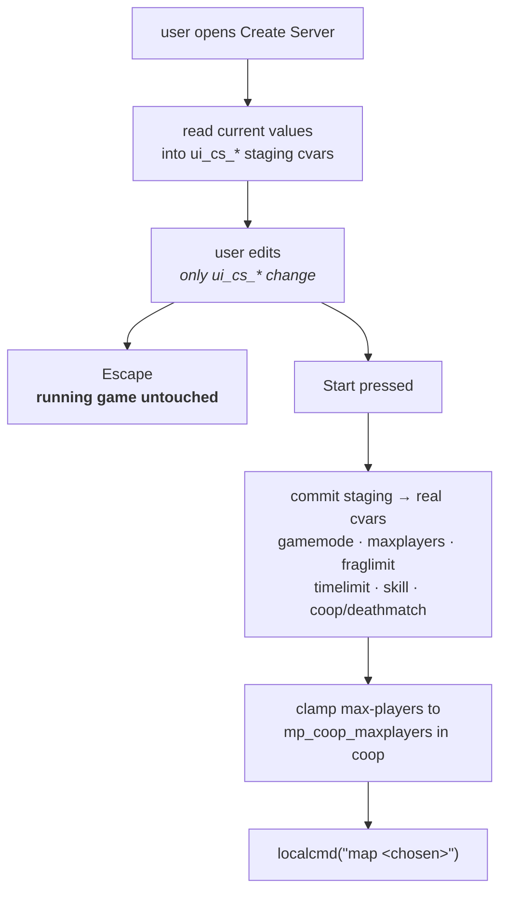

# 11 — The menu (MENUQC)

`data/menu.dat` is loaded **before any server exists** and stays loaded for the
whole session. That is why it, and not CSQC, owns Create Server, Load Game, and
the player setup dialog: those all have to work with no map running.

## Entry points

All frozen — the engine resolves them by name.

| Function | Called |
| --- | --- |
| `m_init()` | once at startup — `RegisterCvars()`, `UI_Init()`, `UI_InitWindows()`, `UI_UpdateSaves()` |
| `m_draw(a, b)` | every frame while visible |
| `m_display()` / `m_hide()` / `m_toggle(n)` | show, hide, and the Escape key |
| `m_keydown(key, ascii)` / `m_keyup(...)` | input |
| `Menu_InputEvent(evtype, scanx, chary, devid)` | newer FTE input path, forwards to `m_keydown`/`m_keyup` |
| `m_shutdown()` | teardown — `void m_shutdown() = {};` |

## Cvar staging — the Create Server pattern

`menuqc/create.qc` is a tabbed dialog (Server / Game) with a scrollable map list
on the left and the server knobs on the right. The rule that makes it safe:

> **Everything the user picks is stored in `ui_cs_*` cvars, registered in
> `main.qc`. They are only converted to real engine and game cvars when Start is
> pressed.**

So browsing the dialog never disturbs a running game. Open the menu mid-session,
poke at the map list and the fraglimit slider, press Escape — nothing changed.

The same staging idea shows up in `playersetup.qc` (name, model, colours) and
`options.qc`.

## Files

| File | Owns |
| --- | --- |
| `main.qc` | entry points, `RegisterCvars()`, window wiring, quit and new-game confirmations |
| `create.qc` | Create Server — map list, rules, staging |
| `server.qc` | server browser / join |
| `load.qc`, `save.qc` | save slot listing, `UI_UpdateSaves()` |
| `options.qc` | settings |
| `playersetup.qc` | name, model, colour |
| `menudefs.qc` | vendored engine ABI — do not edit |

## Menu ↔ game handoff

The menu VM does have entities — `UI_CreateWindow` spawns one per window and
chains them through `.ui_win_next`, with `.ui_win_pos` / `.ui_win_size` holding
the layout. What it does not have is a *world*: no map, no server, and no
connection to `progs.dat`. So it reaches the rest of the system through exactly
two mechanisms:

- **cvars** — staged settings, and the save/load pointers shared with CSQC and
  SVQC (`g_pendingLoad`, `g_lastSaveSlot`, …; see
  [09 — Persistence](09-persistence.md))
- **`localcmd`** — `map`, `load`, `save`, `connect`, `quit`

Load Game is the interesting one, because it crosses all three VMs:

1. MENUQC records the chosen slot in `g_pendingLoad` and issues `load <slot>`.
2. The engine reloads the world **and the CSQC VM**.
3. On the first frame after the new level is up, CSQC's
   `Save_ConsumePendingLoad()` promotes the slot to the death-restore pointer,
   stamped with the loaded map, and clears the cvar.

That last step is what makes "load a save, then die" reload *that* save instead
of pistol-starting the level.

## New Game

Wipes the death-restore pointer and lets `worldspawn`'s fresh-start gate clear
the cross-map tables. Without the wipe, a new campaign could inherit the
previous one's global state and staged inventory.

---

Previous: [10 — Client and HUD](10-client-hud.md) · Next: [12 — Assets](12-assets.md)
