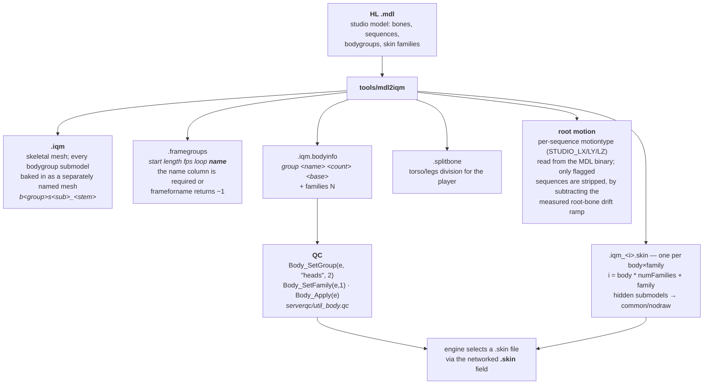

# 12 — Assets: models, materials, lighting

Half-Life ships MDL models, WAD textures, and a studio animation system none of
which a Quake-derived engine understands natively. `tools/mdl2iqm` converts the
models; Q3-style `.shader` materials handle the surfaces; `.rtlights` files
carry the dynamic lighting.

**No game assets are in this repository.** They are extracted by the user from a
legally obtained copy of Half-Life.

## The model pipeline



### Bodygroups and skin families

IQM has no submodel system, so HL's `pev->body` / `pev->skin` are emulated:
every bodygroup submodel is baked into the IQM as a named mesh, and one `.skin`
file per body×family combination maps the hidden ones to `common/nodraw`.

QC keeps the HL semantics in `.body` (auto-populated from the map keyvalue) and
`.skinFamily`. **The engine's `.skin` field is derived** — never set it directly
on a model that ships a `.bodyinfo`. Models without a sidecar are untouched, so
plain `.skin` users keep working.

Hard engine constraints; violating any of them makes the model invisible:

- DarkPlaces/Zircon marks surfaces unmatched by the skin file as NODRAW.
- Surface names must be short (64-character qpath cap) and `[a-z0-9_]` only.
- HL texture names containing parentheses must be sanitised on **both** the
  `.skin` shader side and the staged PNG filename.
- The engine caches models and skin files across `map` — **fully restart** after
  regenerating.
- Launching Zircon programmatically needs `-basedir <repo>` or console commands
  hit a foreign `progs.dat`.

In bodygroup mode a surface is named `b<group>s<sub>_<stem>`, short enough for
the qpath cap and unique per submodel, and the `.skin` file is what maps that
token to a real texture path. A tagged surface has no resolvable texture
without one, so the tagging and the skin files are driven by the same decision:
a model that gets no skin file keeps plain `textures/models/<name>/<stem>`
materials and renders without one.

`.skin` files are written for every model that has bodygroups or more than one
skin family, because nothing in the MDL says which groups the game code will
actually drive. `mdl2iqm.py --skin-groups wpn_scope,wpn_silencer` narrows that
to models carrying one of the named groups, for asset sets where the rest are
static dressing. A model with several skin families keeps its sidecars either
way. Skipping them does not change how a model renders untouched, it only
removes the ability to switch, so the core models (barney's `gun`, the
scientist's `heads` and `needle`, the grunt's `heads` and `weapons`) must never
be converted with a `--skin-groups` list that excludes them.

### Root motion

Locomotion sequences (walk, run, strafe) must play in place while the engine
moves the entity. Conversion reads each sequence's `motiontype` flags from the
MDL binary and strips only the flagged ones, by subtracting the measured
root-bone drift ramp — so deaths and scripted sequences keep their motion.

The flags gate *which* sequences; the drifting axes are *measured*. SMD root
positions are bone-local, so world-X locomotion shows up as local −Y. The old
blanket `--inplace` switch is deprecated.

## Materials — the FTE / DarkPlaces split

`data/scripts/*.shader` are Q3-style materials read by **both** engines from the
same file, and they disagree in ways that produce no warning. Every trap below
was a clean load and a silent visual failure.

`r_showshaders` reports which material a surface actually resolved to. The
engine caches materials across `map`, so a full restart is required after
editing.

### `$lightmap` needs an explicit blendFunc

A bare `{ map $lightmap }` stage has no blendFunc, which means **opaque** — it
replaces every stage drawn before it, wiping the one you care about. Write:

```
{ map $lightmap
  blendFunc GL_DST_COLOR GL_ZERO }
```

As a modulate it is also safe on models: FTE resolves `$lightmap` to white there
(a no-op), while DarkPlaces genuinely uses it to shade the model. Do **not**
"fix" a model shader by deleting the stage — that flattens DP's
`rgbGen const × lighting` into a bare const and reads too bright.

### Never write `cull back`

FTE parses cull qfusion-style: `back` / `backside` / `backsided` mean cull the
**front** faces, so the surface renders inside-out — normals look inverted, or
closed geometry vanishes entirely. The id Tech 3 shader manual says the
opposite; FTE does not follow it.

DarkPlaces only recognises `disable` / `none` / `twosided` and falls through to
normal culling for anything else, so the keyword is a no-op there and the
breakage is FTE-only.

**Omit it — the default is correct on both.** Use `cull none` only when a
surface genuinely needs two sides. Liquids never do (see the water section
below).

> Still outstanding: `hl.shader` (1 block) still carries `cull back`.
> `hl_liquids.shader` has no cull line.

### Water: `dp_water` on the `!` liquids

`data/scripts/hl_liquids.shader` gives every `!` liquid a `dp_water` line:

```
dp_water reflectmin reflectmax refractdistort reflectdistort  refractRGB  reflectRGB  alpha
```

DarkPlaces draws the scene twice (reflection and refraction) and mixes them with
a Fresnel term between `reflectmin` (looking straight down) and `reflectmax`
(grazing). It needs `r_water 1`. Ripples come from a normal map named
`<diffuse>_norm.png` beside the diffuse (`textures/liquids_extracted/`). The
last value multiplies the alpha of the diffuse stage drawn on top, so a small
number such as `0.125` leaves the water almost pure reflection and refraction,
while `0.75` (murky and toxic liquids) lets the texture dominate.

- The numbers are Xonotic's own water values. Clear and blue liquids share one
  row; murky green (`gwater`, `rwater`, `watergreen`) and toxic liquids share
  another.
- Never add `cull none` to a liquid. The compiler emits one face per side of a
  liquid surface (c2a5 has 81 up-facing and 81 down-facing faces at the same
  height), so drawing both sides gives coplanar pairs that z-fight from above.
  FTE also draws the back face as an opaque plane when you are underwater.
- FTE parses `dp_water` too, but builds its own `altwater` GLSL program from it:
  blending is cleared, depth writing is forced, and the output is opaque
  reflection plus refraction. DarkPlaces ignores `alphaGen const` on world
  surfaces, so the stage keeps `alphaGen const 0.65` only for engines where the
  program cannot run.
- `rgbGen identity` with no `$lightmap` stage makes the engine mark the
  material fullbright. Dynamic and realtime lights then never light the water;
  a rocket explosion only shows as a reflection. Stock DarkPlaces water with no
  shader does get lit, and `rgbGen lightingDiffuse` did not change that in
  testing.
- The first definition of a shader name wins. A gamedir overlay that redefines a
  liquid needs a file name that sorts before `hl_liquids.shader`.
- `!toxicgrn` and `!toxicgrn2` (c0a0d, c1a4f, c1a4g, c1a4k) have no block, so
  no water material applies to them.

### `tcGen environment` does nothing on skeletal models in FTE

FTE generates environment texcoords CPU-side and bails to the model's base UVs
when `mesh->normals_array` is null — always true for GPU-skinned IQMs. Symptom:
chrome renders as a static pasted-on texture instead of sliding with the view.
No stage keyword fixes it.

It needs a GLSL `program` doing the projection after skinning:
`data/glsl/chrome.glsl`, wired with `program chrome` at block scope. DarkPlaces
ignores the `program` keyword entirely and keeps using its own working
`tcGen environment`.

### Consequence: brightness is tuned in two places

Once a block carries `program`, **FTE stops reading its `rgbGen` / `tcGen`
lines** and DarkPlaces is the only consumer of them.

- Tune DarkPlaces by editing `rgbGen` in the `.shader`.
- Tune FTE by editing the `light` line in the `.glsl`.

Editing one does nothing to the other.

Corollary: do not bulk-convert `rgbGen const` / `identity` to
`rgbGen lightingDiffuse`. `rgbGen` is one slot, so the const dimming (0.45–0.8
on the rubberglove and worn-steel chrome families) cannot survive the swap.

The full rationale, with the engine source quotes, is in the header comment of
`data/scripts/chrome.shader`.

### Shader catalog

`tools/shader_catalog/` renders the shaders for the website. Everything it makes
lands in `dist/shader-catalog/` (gitignored): stills, a 4 second clip for each
animated shader, WebP copies, a `catalog.json` manifest and contact sheets.

```
python tools/shader_catalog/catalog.py setup      # textures, showroom map, q3map2 compile
python tools/shader_catalog/catalog.py liquids    # every block of hl_liquids.shader
python tools/shader_catalog/catalog.py zircon     # the samples in Zircon's zec_dev_waters
python tools/shader_catalog/catalog.py sheet      # contact sheets
```

- **No third-party art.** The showroom map (`showroom.py`) and its textures
  (`textures.py`) are generated from noise. Each liquid keeps its own `dp_water`
  numbers and `tcMod` lines; only the diffuse is swapped for a noise stand-in
  tinted to the mean colour of the original, and the ripples use a procedural
  normal map. The previews therefore show what the shader does, not the Half-Life
  art, and differ from the shipped `_norm.png` ripples.
- **One launch per shader.** The engine caches shaders across `map`, so each
  block is aliased onto the showroom's `textures/catalog/water` (or `fall` for
  the `+` waterfall) through an overlay file that sorts before `catalog.shader`
  (first definition wins), then rendered in a fresh process.
- **Deterministic clips.** `cl_capturevideo` at 15 fps writes Ogg Theora under
  `<gamedir>/video/`; ffmpeg turns it into MP4 and animated WebP. Clips of
  scrolling water cannot loop seamlessly.
- **q3map2 is needed once** for `setup` (`--q3map2` or the `Q3MAP2` variable).
  Set `LIBRELIFE_EXE` to use another engine build.
- **The `zircon` command reads Zircon's install** through a junction and writes
  only into `dist/shader-catalog/zbase/`. Its shader scripts and textures keep
  their own licences (see Zircon's `credits/` folder) and are not copied here.

## World textures

Half-Life maps take their pixels from WADs (`halflife.wad`, `xeno.wad`,
`liquids.wad`, packed in `data/halflife_wads.pk3`). A loose PNG of the same name
overrides them without touching the WAD or the BSP.

Zircon resolves a BSP texture in this order (`model_brush.c`, texture loading):

1. a q3 shader named after the texture (`data/scripts/*.shader`)
2. `textures/<mapname>/<name>.png`, a per-map variant
3. `textures/<name>.png`
4. the BSP's embedded copy, then the WAD

So a replacement wins over both the WAD and an embedded copy, and a name that has
a shader never reaches the PNG. FTE's lookup has not been checked; test it.

```
python tools/hl_textures.py stage            # extract + collect, data/ untouched
python tools/hl_textures.py install <dir>    # copy replacements into data/textures
python tools/hl_textures.py status           # how many names are replaced
```

`stage` unpacks the WADs into `.hltex/wad/`, runs WadMaker on each
(`WADMAKER` or `--wadmaker` points at `WadMaker.exe`), and collects the textures
the shipped BSPs reference as lowercase PNGs in `.hltex/textures/`, with
`manifest.json` and `manifest.csv` (name, source WAD, class, size, maps using it).
`.hltex/` is gitignored, like every `*.png`; converted Valve copies stay local.
The manifest is the work list for replacements. Tool textures (`sky`, `clip`,
`origin`, `aaatrigger`), names that already have a shader, the `!` liquids and the
textures embedded only in community maps are listed but not staged.

`install` refuses a replacement that would break the material:

- the name must be in the manifest (a typo would silently never load)
- same aspect ratio as the original; any resolution works, because texcoords use
  the size stored in the BSP, not the PNG
- opaque textures must be fully opaque. One pixel under alpha 255 turns the
  surface into a blended material
- `{` textures keep a real alpha cutout, they are alpha tested
- a file already in `data/textures/` (any of png, tga, jpg, dds) is skipped, so
  existing files and earlier replacements are never clobbered; `--force`
  replaces only an existing `.png`

Rules for the art itself:

- lowercase file name equal to the texture name, e.g. `+0button1.png`, `{bars.png`
- `+0name`, `+1name` ... are separate PNGs, one per frame; `-0name` is plain
- under transparent pixels keep the neighbouring colour instead of black or blue,
  or fences get a dark fringe when mipmapped
- liquids (`!`) are shader driven: replace `textures/liquids_extracted/<name>.png`
  and its `_norm.png`, not a flat file
- `data/textures/` is shared by every gamedir whose base game is `data`, and by
  `tools/web_build.py`, so large replacements grow those too

## Lighting

`data/maps/*.rtlights` supply real-time lights for all 131 Half-Life maps,
generated by `tools/gen_rtlights.py` from the map entity lump. Light styles
(flicker, pulse, strobe) are set up in `worldspawn` via `lightstyle(0..63)` —
`'a'` is total darkness, `'z'` is maximum brightness.

`light_environment` (HL's sun) is not yet handled.

## Sounds and text data

| File | Loaded by | Contains |
| --- | --- | --- |
| `data/sound/sentences.txt` | `Sentences_Init()` at `worldspawn` | named groups of voice lines; `Sentences_Play` picks a random variant |
| `data/titles.txt` | `Titles_Init()` | `env_message` / `game_text` strings and their display parameters |

Both are parsed with `fopen` / `fgets` / `fclose`, which resolve under
`gamedir/` — so `"sound/sentences.txt"` reads `data/sound/sentences.txt`.

### Delayed sounds

`src/sound.qc` is the only file that calls the engine sound builtin, and
everything funnels through `Sound_Emit`. Alongside the immediate calls it offers
a server-side pair for sounds that have to land partway through an animation
rather than when the animation starts:

```c
entity Sound_PlayDelayed(entity src, float delay, float chan,
                         float fvol, float attn, float pitch, string smp);
void   Sound_CancelDelayed(entity src);
```

A reload is the case that forced this. The magazine clack belongs half a second
into a three second sequence, and the alternative is hijacking the caller's own
`.think` to wake up and fire it — which stops the caller doing anything else for
that half second, and means the reload has to be written as a chain of
think hops whose split points are guessed rather than measured.

Each pending sound is one entity of classname `delayed_sound`, owned by the
source, so several can be in flight at once and each can be dropped on its own.
It plays through `Sound_Play`, so the builtin still has one caller. The sample is
`strzone`d, so a caller may build the name with `strcat`.

**Cancelling is the caller's job.** Nothing is stored on the pending sound to
say whether it is still wanted; `Sound_CancelDelayed` is called from the code
that knows the action was abandoned — a weapon switch, a death. A guard baked
into the sound system would have to answer "is this still valid" for players,
monsters and brushes alike, and there is no spelling of that which is right for
all three. An owner that has been removed is the one case handled here: its
pending sounds go quiet on their own.

## Tooling

`tools/mdl2iqm` and `tools/QuakeGameBuilder` are **git submodules**. Clone with
`--recursive`, or run `git submodule update --init --recursive` afterwards.

The `mdl2iqm*.bat` files at the repo root are the conversion entry points
(`mdl2iqm_character.bat` and `mdl2iqm_player.bat` carry the character and player
specific flags).

---

Previous: [11 — Menu](11-menu.md) · Next: [13 — Entity behaviour notes](13-entity-notes.md)
