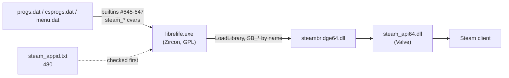

# 18 — Steam

Libre-life's Windows engine can use Steam: relayed multiplayer without port
forwarding, friend invites, "Join game" from the friends list, and the
achievement and overlay builtins. All of it comes from
[SteamBridge](https://github.com/KleskBY/Steam-SDK-Bridge-for-DarkPlaces),
pinned in this repo as the submodule [`tools/SteamBridge`](../../tools/SteamBridge).

Steam is optional at every level. Without the bridge files, without
`steam_appid.txt`, or without a running Steam client, the game starts and plays
exactly as before; the only trace is a console line.

The bridge's own documentation is the reference for the details; this page
covers how Libre-life uses it:

- [README](https://github.com/KleskBY/Steam-SDK-Bridge-for-DarkPlaces#readme): building the DLL, deployment, troubleshooting, licensing
- [API.md](https://github.com/KleskBY/Steam-SDK-Bridge-for-DarkPlaces/blob/main/docs/API.md): every exported function
- [ENGINE_INTEGRATION.md](https://github.com/KleskBY/Steam-SDK-Bridge-for-DarkPlaces/blob/main/docs/ENGINE_INTEGRATION.md): engine hook points, cvars, commands
- [QC.md](https://github.com/KleskBY/Steam-SDK-Bridge-for-DarkPlaces/blob/main/docs/QC.md): QuakeC usage with examples

## How the pieces fit



The engine half is already compiled into `librelife.exe` (Zircon's
`steam.c` / `steam_net.c`). It contains no Steam code of its own: it looks for
`steam_appid.txt` in the working directory, then loads `steambridge64.dll` and
calls it through function pointers. `steambridge64.dll` is the only thing that
links Valve's SDK.

## What ships

A Windows build carries three extra files next to `librelife.exe`:

| File | Source |
| --- | --- |
| `steambridge64.dll` | built from `tools/SteamBridge` (see [Building](../contributing/building.md#steam-bridge)) |
| `steam_api64.dll` | Valve's Steamworks SDK redistributable, version 1.62 |
| `steam_appid.txt` | tracked in the repo root, contains `480` |

`tools/QuakeGameBuilder/builder_config.json` lists all three under `includes`,
so every build copies them; a build fails with `Include path not found` if one
is missing rather than shipping without Steam. Their licence notes are in
[`licenses/`](../../licenses).

Only Windows has Steam. `fteqw64.exe`, the Linux `librelife-sdl` /
`librelife-dedicated` binaries and the [Android port](17-android-port.md) run
without it.

## App ID 480

`480` is Spacewar, Valve's public test application, which every Steam account
can run. With it, test builds get the full relay, invite and overlay feature set
without a Steamworks app of our own. Friends see you as "playing Spacewar".

The root `steam_appid.txt` also switches Steam on for development runs started
from the repo root (`./librelife.exe -basedir . -game data`) whenever the Steam
client is running. Delete the file locally if you want a Steam-free session.

A release on Steam replaces `480` with Libre-life's own app ID and leaves
`steam_appid.txt` out of the depot, because Steam passes the app ID itself when
it launches the game.

## What Libre-life uses today

**Relay multiplayer.** A server started with `maxplayers` above 1 also listens
on Steam Datagram Relay, and the engine publishes the address in the read-only
cvar `steam_fakeip` (`a.b.c.d:port`). Players `connect` to that address like any
IP; no port forwarding on either side. Friends can also press "Join game" in the
Steam friends list, or be invited with `steam_invite` (overlay dialog) or
`steam_invite <steamid64>`. Ordinary UDP hosting keeps working alongside.

The relay hands out the address asynchronously, starting at engine start-up,
and the server reads it each time it opens its ports on a map load. A server
started in the first seconds after launch (`+map` on the command line) can show
an empty `steam_fakeip` until its next map load.

**Create Server.** [`menuqc/create.qc`](../../src/menuqc/create.qc) shows the
"Forward UDP port" hint for an Internet game only when `steam_steamid` is empty,
since with Steam up the relay makes forwarding unnecessary.

**Console.** `steam_steamid` holds your SteamID64 once Steam is up (and is the
test for "is Steam up"); `developer_steam 1` shows the relay library's messages.

**Not wired yet.** [`gamedefs.qc`](../../src/gamedefs.qc) registers the client
commands `steamcmd` and `steam_resetachievements`, but nothing handles them, and
the three Steam builtins are not declared anywhere under `src/`. Libre-life has
no achievements defined yet. The pattern for adding them is below.

## Using Steam from QuakeC

The builtins, the same numbers in all three VMs:

```c
float(string achievement_name) steam_achievement_unlock = #645;
float(string achievement_name) steam_achievement_lock = #646;
void(string url) steam_open_url = #647;
```

Gate every achievement call on Steam actually being up. The builtins exist on
this engine even when Steam failed to start. The current bridge then returns 0
and logs `Steam not initialized, ignoring achievement`, but a bridge built
before 2026-10-29 crashes instead, so test first:

```c
float Steam_Available()
{
	if (strlen(cvar_string("steam_steamid")) < 3)
		return FALSE;
#ifndef MENUQC
	if (!cvar("pr_checkextension"))
		return FALSE;
	if (!checkextension("KLESKBY_STEAM"))
		return FALSE;
#endif
	return TRUE;
}
```

Separate `if`s, not one `||`: `&&` / `||` do not short-circuit in this build
and `checkextension` must not run when `pr_checkextension` is 0. 
The menu VM does not advertise `KLESKBY_STEAM`, hence the `#ifndef`.

Unlock once and remember it, from **client** QC (the server process is not the
player whose Steam account should get the achievement):

```c
void Steam_AchievementUnlock(string name)
{
	if (!Steam_Available())
		return;
	string latch = strtolower(name);
	if (cvar(latch))
		return;
	if (steam_achievement_unlock(name))
		localcmd(strcat("seta ", latch, " 1\n"));
}
```

Show an "Invite friend" button only while hosting through the relay:

```c
if (strlen(cvar_string("steam_fakeip")) > 3 && clientcount() > 1)
	UI_Button("Invite friend", pos, UI_Cmd, "steam_invite\n");
```

More examples, including awarding at intermission, a reset command for testing,
and opening a web page, are in the bridge's
[QC.md](https://github.com/KleskBY/Steam-SDK-Bridge-for-DarkPlaces/blob/main/docs/QC.md).
Under app ID 480 only Spacewar's own achievement names exist (`ACH_WIN_ONE_GAME`
and four others), so custom names fail until Libre-life has its own app ID.

## Checking it works

1. Start the Steam client and log in.
2. Run `librelife.exe` from a build folder (or the repo root).
3. The console shows `Steam: successfully initialized`, `steam_steamid` prints a
   17-digit number, and Steam shows you as playing Spacewar.
4. Host with `maxplayers 2` or more from the menu: `steam_fakeip` holds an
   address. A second machine can `connect` to it.
5. Close Steam and start again: the game runs normally and logs
   `SteamAPI_Init error`.

If step 3 fails, the
[troubleshooting table](https://github.com/KleskBY/Steam-SDK-Bridge-for-DarkPlaces#troubleshooting)
maps each console message to its cause.
